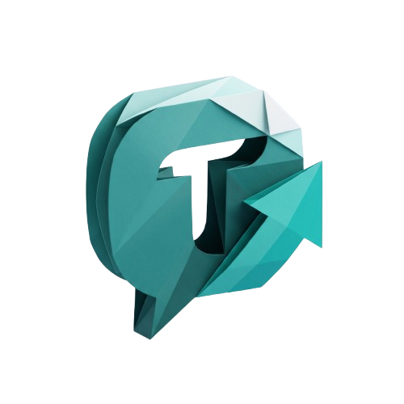
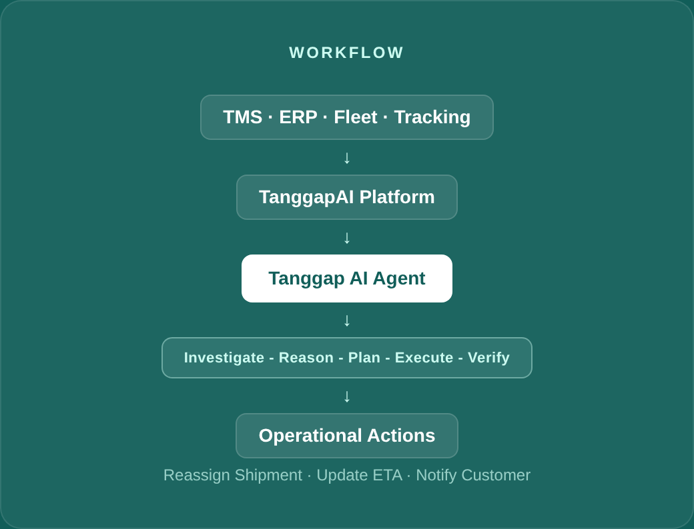

<div align="center">



### Masalah terjadi. TRACIA tangani.

**AI Agent untuk menangani exception operasional logistik — dari investigasi sampai verifikasi.**

[Live Demo](https://tracia-ai.vercel.app) &nbsp;·&nbsp; [Repository](https://github.com/yogawan/tracia)


</div>

---

## Apa itu TRACIA?

Ketika sebuah shipment bermasalah — kendaraan rusak, driver tidak tersedia, rute terblokir, ETA berubah — operator biasanya harus mengecek status, mencari penyebab, mencari resource pengganti, menjalankan perubahan, menghubungi customer, lalu memastikan semuanya benar-benar selesai. Semua langkah itu manual dan tersebar di banyak sistem.

**TRACIA menjalankan rangkaian itu sebagai satu AI Agent.** Operator cukup memberi instruksi seperti *"Selesaikan shipment SH-8821"*, dan TRACIA melakukan investigasi, analisis, perencanaan, eksekusi, hingga verifikasi hasil — dengan operator tetap memegang kendali atas tindakan yang berisiko.

*TRACIA (sebelumnya bernama TanggapAI) juga adalah nama maskot platform ini, merepresentasikan karakter yang sigap dan responsif.*

## Kenapa ini penting

- **Data tersebar.** Status shipment, kendaraan, driver, dan rute hidup di sistem yang berbeda-beda — TMS, ERP, Fleet, Tracking.
- **Recovery masih manual.** Setiap exception butuh operator menghubungkan data itu sendiri dan memutuskan tindakan satu per satu.
- **Verifikasi sering terlewat.** Tindakan yang berhasil "terkirim" ke sistem belum tentu berarti masalah benar-benar selesai.

TRACIA tidak menggantikan TMS atau ERP yang sudah ada. TRACIA bekerja *di atas* sistem tersebut, melalui API dan tools yang diizinkan.

## Cara kerja

Setiap permintaan diproses melalui lima tahap yang sama:

| Tahap | Yang dilakukan TRACIA |
| --- | --- |
| 1. **Investigate** | Mengumpulkan data shipment, kendaraan, driver, dan exception. |
| 2. **Reason** | Menganalisis data untuk menemukan akar masalah. |
| 3. **Plan** | Menyusun recovery plan berdasarkan resource yang tersedia. |
| 4. **Execute** | Menjalankan tindakan melalui tools yang diizinkan. |
| 5. **Verify** | Memeriksa hasil eksekusi terhadap kondisi aktual sebelum melaporkan selesai. |

**Contoh.** Operator mengetik *"Selesaikan shipment SH-8821."* TRACIA menemukan kendaraan B 1234 XYZ mengalami breakdown, mencari kendaraan dan driver pengganti yang tersedia, meminta persetujuan operator untuk reassignment, lalu menjalankan perubahan, memperbarui ETA, mengirim notifikasi ke customer, dan memverifikasi bahwa shipment benar-benar pulih — bukan hanya "terkirim".

```text
getShipment() → getException() → findAvailableVehicle() → findAvailableDriver()
→ requestApproval() → reassignShipment() → verifyResolution()
```



## Yang bisa kamu lakukan di TRACIA

- **Investigasi shipment** — tanya status, customer, driver, kendaraan, dan exception dalam satu percakapan.
- **Minta root cause analysis** — "Kenapa SH-8821 terlambat?" dijawab dengan evidence dari data, bukan tebakan.
- **Minta recovery plan** — TRACIA menyusun langkah penyelesaian lengkap dengan resource pengganti yang tersedia.
- **Jalankan tindakan lewat agent** — reassignment, update ETA, notifikasi customer, dengan approval untuk langkah berisiko.
- **Pantau dari dashboard** — total shipment, shipment terlambat, exception kritis, exception terselesaikan, dan resolution rate dalam satu overview (`/overview`).
- **Lihat demo** — rekaman skenario end-to-end di `/demo` tanpa menyentuh data asli.

## Kendali & keamanan

- **Restricted Tools.** TRACIA hanya dapat memanggil tools yang memang diizinkan — tidak ada akses database langsung dari LLM.
- **Human Approval.** Tindakan berisiko (reassignment, ganti driver/kendaraan, kirim notifikasi) menunggu persetujuan operator.
- **Verified Results.** TRACIA memeriksa respons sistem sebelum menyatakan sebuah exception selesai.

> "Autonomous when possible. Human-in-the-loop when necessary."

## Arsitektur singkat

```text
User / Operator
      ↓
Next.js App (Dashboard + Agent Chat)
      ↓
Agent Orchestrator (Context Manager, Planner, Tool Registry, Guardrails)
      ↓
LLM — DeepSeek (utama), Groq (fallback dev)
      ↓
Tool Layer (Shipment, Driver, Vehicle, Exception, Notification)
      ↓
Mongoose → MongoDB Atlas
```

LLM tidak pernah menyentuh database secara langsung — setiap tindakan lewat tool call yang divalidasi terlebih dahulu.

## Getting Started

Salin environment variables lalu isi dengan kredensial milikmu:

```bash
cp .env.example .env.local
```

Variabel yang dibutuhkan:

| Variabel | Keterangan |
| --- | --- |
| `MONGODB_URI` | Connection string MongoDB Atlas. |
| `DEEPSEEK_API_KEY` | API key DeepSeek (LLM provider utama). |
| `GROQ_API_KEY` | API key Groq, dipakai jika `LLM_PROVIDER=groq` (fallback dev, gratis). |

Jalankan development server:

```bash
npm run dev
# atau
yarn dev
# atau
pnpm dev
# atau
bun dev
```

Buka [http://localhost:3000](http://localhost:3000) untuk melihat hasilnya.

Untuk mengisi data contoh (shipment, kendaraan, driver, exception) ke MongoDB:

```bash
npm run seed
```

## Pertanyaan yang sering diajukan

<details>
<summary><b>Apa itu TRACIA?</b></summary>
TRACIA adalah platform AI Agent untuk membantu menangani exception operasional logistik.
</details>

<details>
<summary><b>Siapa TRACIA?</b></summary>
TRACIA adalah AI Agent sekaligus maskot yang merepresentasikan karakter sigap dan responsif.
</details>

<details>
<summary><b>Apakah TRACIA menggantikan TMS atau ERP?</b></summary>
Tidak. TRACIA bekerja di atas sistem yang sudah ada melalui API dan tools yang tersedia.
</details>

<details>
<summary><b>Apakah TRACIA bisa bertindak otomatis?</b></summary>
TRACIA dapat menjalankan tindakan yang diizinkan. Tindakan tertentu memerlukan persetujuan operator.
</details>

<details>
<summary><b>Bagaimana TRACIA mengetahui tindakan berhasil?</b></summary>
TRACIA memeriksa hasil tool dan status aktual dari sistem sebelum melaporkan penyelesaian.
</details>

<details>
<summary><b>Apakah integrasi logistik sudah tersedia?</b></summary>
Prototype menggunakan simulated logistics API sampai integrasi eksternal diimplementasikan.
</details>

## Status

TRACIA masih berstatus **prototipe kompetisi** (UINIC 7.0), belum terhubung ke vendor TMS/ERP/Fleet sungguhan:

- Integrasi logistik saat ini memakai **simulated logistics API**, bukan sistem vendor nyata.
- Fokus MVP adalah exception tipe **vehicle breakdown**; driver unavailable, route blocked, dan late delivery direncanakan sebagai extension berikutnya.
- Success metrics (resolution rate, average resolution time, dll.) akan diukur dari pengujian nyata, bukan diklaim sebagai angka final sebelum pengujian tersedia.

## Links

| | |
|---|---|
| **Live Demo** | [tracia-ai.vercel.app](https://tracia-ai.vercel.app) |
| **Repository** | [github.com/yogawan/tracia](https://github.com/yogawan/tracia) |

## Tim Pengembang

Proyek ini dikembangkan oleh **Tim CH Miaw Miaw Ali Kristen** untuk kompetisi UINIC 7.0:

| Nama | NIM | Role |
| --- | --- | --- |
| Lathif Ramadhan | 5231811022 | Ketua Tim & AI Developer |
| Ali Sahat Pardomuan P. | 5220411321 | Frontend Developer |
| Yogawan Aditya Pratama | 5220411056 | UI/UX & Frontend Assistant |

---

<div align="center">

Dibangun oleh **Tim CH Miaw Miaw Ali Kristen** untuk UINIC 7.0

</div>
